# Beats Video Editor — Complete Codebase Architecture & Code Walkthrough

> **Purpose of this Document:**  
> This document provides an exhaustive, line-by-line and module-by-module explanation of the entire **Beats Video Editor** codebase. It is designed so that any software engineer, video engineer, or researcher can understand every single design decision, mathematical formula, algorithm, data structure, FFmpeg filter chain, and configuration parameter in this project.

---

## Table of Contents

1. [Executive Summary & High-Level Architecture](#1-executive-summary--high-level-architecture)
2. [End-to-End Execution Flow (Mermaid Diagram)](#2-end-to-end-execution-flow-mermaid-diagram)
3. [Core Technical & Mathematical Concepts](#3-core-technical--mathematical-concepts)
   - 3.1 Audio Signal Processing (`librosa`, Onset Envelopes, Spectral Flux)
   - 3.2 Computer Vision (`OpenCV`, Farneback Optical Flow, Scene Detection)
   - 3.3 Combinatorial Optimization (Hungarian Bipartite Matching vs. Greedy Heuristic)
   - 3.4 Media Engineering (FFmpeg Filter Graphs, Color Grading Curves, Hardware Acceleration)
4. [File-by-File & Function-by-Function Breakdown](#4-file-by-file--function-by-function-breakdown)
   - 4.1 `requirements.txt`
   - 4.2 `app/__init__.py`
   - 4.3 `app/logging_system.py`
   - 4.4 `app/progress_tracker.py`
   - 4.5 `app/cache.py`
   - 4.6 `app/theme.py`
   - 4.7 `app/beat.py`
   - 4.8 `app/video.py`
   - 4.9 `app/sync.py`
   - 4.10 `app/main.py`
   - 4.11 `app/frontend.py`
   - 4.12 `tools/benchmark.py`
   - 4.13 `tools/run_headless_test.py`
   - 4.14 `README.md`
5. [Engineering Nuances, Traps & Historical Bugs Solved](#5-engineering-nuances-traps--historical-bugs-solved)
6. [System Configuration & Hyperparameters Reference Table](#6-system-configuration--hyperparameters-reference-table)

---

## 1. Executive Summary & High-Level Architecture

**Beats Video Editor** is an autonomous, AI-assisted video editing system. It ingests:
1. One or more unedited, full-length source videos (e.g., MP4, MOV, WEBM, MKV).
2. A single musical audio track (e.g., MP3, WAV, M4A, AAC).

Without any human intervention, the engine analyzes musical dynamics (beats, tempo, drops, buildups, sections), analyzes visual content (scene changes, optical flow motion magnitude, highlights, visual clarity), intelligently pairs video segments with musical bars, normalizes frame rates, resolutions, and color tones, and stitches the final video using transitions synchronized to musical beats.

### Architectural Pillars

```
┌─────────────────────────────────────────────────────────────────────────────┐
│                           BEATS VIDEO EDITOR                                │
├───────────────────────────────┬─────────────────────────────────────────────┤
│ Frontend & Ingestion Layer    │ Streamlit UI + Local Path Streaming         │
│ Telemetry & Logging Layer     │ Rotating Loggers + Weighted ProgressTracker │
│ Caching & Persistence Layer   │ Thread-Safe MD5 Stat Caching (JSON)         │
│ Audio Signal Processing Layer │ Librosa Onset Strength + Chroma + RMS Flux  │
│ Computer Vision Layer         │ OpenCV Farneback Flow + FFmpeg Scene Select │
│ Combinatorial Matching Engine │ Hungarian Algorithm + Greedy Heuristic      │
│ Rendering & Transcoding Engine│ Single-Pass FFmpeg Graph + Intel QSV / x264 │
└───────────────────────────────┴─────────────────────────────────────────────┘
```

---

## 2. End-to-End Execution Flow (Mermaid Diagram)

```mermaid
flowchart TD
    subgraph Ingestion["1. Ingestion & Pre-flight"]
        A[User Inputs: Video Paths + Music File] --> B{Disk Space & RAM Check}
        B -->|Sufficient| C[Initialize ProgressTracker & Logging]
        B -->|Insufficient| B1[Raise Storage Warning / Error]
    end

    subgraph AudioAnalysis["2. Music & Beat Intelligence (app/beat.py)"]
        C --> D[Librosa Audio Load]
        D --> E[Onset Strength Envelope & Beat Tracking]
        E --> F[Energy Curve RMS & Spectral Flux]
        F --> G[Drop & Buildup Detection]
        G --> H[Chroma CQT Section Segmentation]
        H --> I[Normalized Beats & Music Metadata]
    end

    subgraph VideoIntelligence["3. Video Analysis & Candidate Generation (app/video.py)"]
        I --> J[Probe Video Durations & Metadata]
        J --> K[Detect Scene Boundaries via FFmpeg select='gt scene,0.3']
        K --> L[Generate Candidate Start Times: Scene Anchors + Uniform Grid]
        L --> M[Compute Optical Flow Motion via OpenCV Farneback]
        M --> N[Extract Highlights, Camera Changes & Visual Clarity]
    end

    subgraph MatchingEngine["4. Alignment & Clip Assignment (app/sync.py)"]
        N --> O[Create Adaptive Beat Groups: min_beats to max_beats]
        O --> P[Classify Beat Types: drop, buildup, downbeat, regular]
        P --> Q{Problem Complexity: beats × candidates <= 5000?}
        Q -->|Yes| R[Hungarian Algorithm: Global Cost Matrix Optimization]
        Q -->|No| S[Greedy Heuristic Assignment with Chronological Cursors]
        R --> T[Assigned Timeline Intervals with Diversity Penalties]
        S --> T
    end

    subgraph RenderingEngine["5. Rendering & Post-Processing (app/video.py)"]
        T --> U{Rendering Mode}
        U -->|Preferred| V[Single-Pass Render: Multi-Input -filter_complex]
        U -->|Fallback| W[Multi-Pass Pipeline: process_clip -> concat -> remux]
        V --> X[Trim + Scale/Crop Lanczos + Color Grade + xfade + Audio Mux]
        W --> X
        X --> Y[Intel QSV or CPU libx264 Hardware Encoding]
        Y --> Z[Final Beat-Synced Video Output .mp4]
    end
```



---

## 3. Core Technical & Mathematical Concepts

### 3.1 Audio Signal Processing (`librosa`)
- **Onset Strength Envelope ($O_t$):**  
  Measures the spectral flux across frequency bins over time. Given a short-time Fourier transform (STFT) magnitude spectrogram $S(f, t)$, onset envelope is computed as:
  $$O(t) = \sum_{f} \max(0, S(f, t) - S(f, t - 1))$$
  Peaks in $O(t)$ correspond to acoustic note onsets, drum hits, or percussive accents.
- **Beat Tracking (Ellis / Dynamic Programming):**  
  Librosa identifies beat frames by finding a sequence of timestamps that maximizes correlation with $O(t)$ while maintaining tempo consistency (penalizing deviations from median inter-beat intervals).
- **RMS Energy & Spectral Flux:**  
  $$\text{RMS}(t) = \sqrt{\frac{1}{N} \sum_{n=0}^{N-1} x[n + t \cdot H]^2}$$
  Spectral flux differential $\Delta \text{RMS} = \text{RMS}[t] - \text{RMS}[t-1]$ identifies sudden energy explosions. When $\text{RMS} > 0.6$, flux $> 0.3$, and energy surges by $> 1.5\times$, a **musical drop** is flagged.
- **Chroma CQT (Constant-Q Transform):**  
  Projects audio frequencies into 12 semitone pitch classes across octaves. The cosine distance or differential across adjacent time frames identifies structural section boundaries (intro, verse, chorus, drop, bridge, outro).

### 3.2 Computer Vision (`OpenCV` & FFmpeg)
- **Farneback Dense Optical Flow:**  
  Computes the 2D motion vector field $(u, v)$ between consecutive video frames:
  $$\text{Magnitude}(x, y) = \sqrt{u(x, y)^2 + v(x, y)^2}$$
  To maintain near-real-time performance, frames are downscaled by $1/16$ (`MOTION_DOWNSCALE = 0.0625`), converted to single-channel 8-bit grayscale, and computed using a 3-level image pyramid with polynomial expansion.
- **Scene Change Detection:**  
  FFmpeg's internal scene detection filter computes the normalized sum of absolute differences (SAD) across consecutive color histograms:
  $$\text{Scene Score} = \frac{\sum |I_t - I_{t-1}|}{\text{Total Pixels}}$$
  When this exceeds `SCENE_THRESH` (default $0.30$ to $0.40$), a scene boundary timestamp is recorded.
- **Laplacian Variance for Blur Detection:**  
  $$\sigma^2 = \text{Var}(\nabla^2 I)$$
  A high variance indicates sharp, high-frequency edges; a low variance indicates motion blur or unfocused footage.

### 3.3 Combinatorial Optimization & Clip Matching
- **The Hungarian Method ($O(N^3)$):**  
  Treats video assignment as a weighted bipartite matching problem between $N$ beat intervals and $M$ candidate video clips. Cost is defined as:
  $$C_{i, j} = 1.0 - \text{Score}(i, j)$$
  Constraints such as clip overlap, source video reuse caps, and negative temporal progression are penalized with $C_{i, j} = \infty$.
- **Greedy Heuristic with Chronological Cursors:**  
  For larger timelines ($N \times M > 5000$), a greedy selector scans candidates for each beat group sequentially. It maintains a per-video cursor ensuring source footage progresses chronologically (`ENFORCE_ASCENDING_ORDER = True`), preventing erratic back-and-forth jumps in narrative.
- **Diversity Penalty Decay:**  
  To prevent re-using clips too close to previously selected intervals from the same source file, an asymmetric penalty is computed:
  $$\text{Penalty}(d) = \begin{cases} 
  1.5 & \text{if } 0 < d < \text{MIN\_CLIP\_GAP} \text{ (Hard Rejection)} \\
  1.0 - 0.7 \cdot \frac{d - 3.0}{15.0 - 3.0} & \text{if } 3.0 \le d \le 15.0 \\
  0.0 & \text{if } d > 15.0 
  \end{cases}$$

### 3.4 Media Engineering (FFmpeg)
- **Lanczos Scaling + Center Crop:**  
  Standardizes disparate source aspect ratios (4:3, 16:9, vertical 9:16) into standard 16:9 landscape (`1920x1080`) by scaling to fill the target rectangle (`force_original_aspect_ratio=increase`) followed by center cropping (`crop=1920:1080`), ensuring no black bars or aspect ratio distortion.
- **Cinematic Tone Mapping & Curves:**  
  Applies BT.709 broadcast color space conversion, shadow lifts, and Cineon-style S-curves to ensure consistent contrast and color gamut across clips shot on different cameras/phones.
- **Single-Pass Filter Graph:**  
  Rather than writing intermediate MP4 files for every clip to disk, a complex FFmpeg graph trims each source file in memory, chains transitions (`xfade`) with precise timestamp offsets, grades the final composite, loops audio, and encodes in a single pass.

---

## 4. File-by-File & Function-by-Function Breakdown

```
beats-video-editor/
├── requirements.txt
├── README.md
├── app/
│   ├── __init__.py
│   ├── logging_system.py
│   ├── progress_tracker.py
│   ├── cache.py
│   ├── theme.py
│   ├── beat.py
│   ├── video.py
│   ├── sync.py
│   ├── main.py
│   └── frontend.py
└── tools/
    ├── benchmark.py
    └── run_headless_test.py
```

---

### 4.1 `requirements.txt`
Specifies the exact Python ecosystem dependencies:
1. `librosa`: Music information retrieval (MIR) library for beat tracking, spectral onset analysis, chroma feature extraction, and RMS energy calculations.
2. `numpy`: High-performance multidimensional arrays and mathematical vector operations.
3. `soundfile`: Fast C-library-backed audio file reading and writing.
4. `scipy`: Scientific algorithms, specifically `scipy.optimize.linear_sum_assignment` (the Hungarian algorithm implementation).
5. `numba`: JIT compiler accelerating internal librosa signal processing loops.
6. `streamlit`: Reactive web application framework providing the user dashboard and parameter sliders.
7. `opencv-python`: Computer vision library used for dense Farneback optical flow calculations and frame analysis.
8. `Pillow`: Python Imaging Library for reading raw RGB/PNG pipes emitted from FFmpeg stdout.
9. `psutil`: OS process inspection library used to monitor process RSS memory usage and prevent out-of-memory crashes.
10. `pytest`: Testing suite framework.

---

### 4.2 `app/__init__.py`
Defines package metadata and documents the modular architecture of the codebase. It ensures `app` is recognized as a Python package and outlines submodule roles:
- `app.beat`: Music beat detection and acoustic analysis.
- `app.sync`: Beat grouping, candidate scoring, and clip assignment.
- `app.video`: FFmpeg integration, scene detection, optical flow, and rendering.
- `app.cache`: File-hash-based caching singleton.
- `app.progress_tracker`: Multi-stage progress tracking and ETA calculations.
- `app.logging_system`: Singleton logging manager with rotating file handlers.
- `app.theme`: Experimental / legacy MoviePy themes.
- `app.frontend`: Streamlit GUI.

---

### 4.3 `app/logging_system.py`

#### Architecture
Implements a process-wide, thread-safe singleton `LogManager` managing four isolated rotating log files (`logs/app.log`, `logs/render.log`, `logs/analysis.log`, `logs/ffmpeg.log`) plus terminal output and an optional frontend callback hook.

#### Key Components:
- **`class LogManager`:**
  - `_instance`, `_lock`: Implements the classic double-checked locking singleton pattern in `__new__` to guarantee only one logger instance exists across worker threads.
  - `_setup_loggers()`: Creates `logs/` directory, initializes loggers for `"app"`, `"render"`, `"analysis"`, and `"ffmpeg"`, sets their levels to `DEBUG`, and sets `propagate = False` to prevent duplicate log records bubbling up to the root Python logger.
  - `RotatingFileHandler`: Configured with `maxBytes=10_000_000` (10 MB) and `backupCount=5`, ensuring log files never exhaust disk space.
  - `StreamHandler(sys.stdout)`: Console logger filtering at `INFO` level to prevent terminal clutter while keeping full `DEBUG` records on disk.
  - `set_frontend_logger(callback)`: Registers a callback function (such as a Streamlit UI update or queue) receiving user-facing status messages with emojis (`ℹ️`, `⚠️`, `❌`).
  - Specialized log methods:
    - `ffmpeg_command(cmd)`: Logs the full subprocess command line argument list.
    - `ffmpeg_output(line)`: Captures FFmpeg stderr output at `DEBUG` level to prevent terminal flooding.
    - `stage_start(stage_num, total_stages, name)` and `stage_complete(...)`: Formats structured stage progression milestones.
- **Global Helper Functions:**
  - `get_logger() -> LogManager`: Returns the singleton instance.
  - `init_logging(log_dir)`: Reinitializes log directory if customized.

---

### 4.4 `app/progress_tracker.py`

#### Architecture
Provides thread-safe, weighted stage progression tracking and predictive ETA calculation for long-running batch video operations.

#### Key Components:
- **`@dataclass class StageProgress`:**
  Holds metadata for a discrete phase: `name`, `weight` (relative contribution to 100%), `started_at`, `completed_at`, `progress` (0.0 to 1.0), and human-readable `details`.
- **`@dataclass class ProcessingStats`:**
  Maintains live operational telemetry: `videos_analyzed`, `total_videos`, `scenes_detected`, `clips_generated`, `timeline_progress`, `generated_duration`, `target_duration`, `elapsed_time`, and `estimated_remaining`.
- **`class ProgressTracker`:**
  - `lock = threading.RLock()`: Uses a **Re-entrant Lock** (crucial fix from `ISSUES_LOG.md` to prevent deadlock when `_notify()` calls `get_dashboard_data()` while holding the instance lock).
  - `start_stage(stage_idx, details)`: Marks a stage as active, records start timestamp, resets progress to 0, and notifies listeners.
  - `update_stage_progress(stage_idx, progress, details)`: Clamps progress to $[0.0, 1.0]$. Throttles ETA recalculation to at most once every 0.5s to reduce arithmetic overhead.
  - `complete_stage(stage_idx)`: Sets stage progress to 1.0, records completion timestamp, appends stage duration to historical telemetry, and recalculates ETA.
  - `_calculate_eta()`:
    $$\text{Overall Progress} = \frac{\sum_{i=0}^{\text{current}-1} W_i + W_{\text{current}} \cdot P_{\text{current}}}{\sum_{j} W_j}$$
    $$\text{Estimated Total Time} = \frac{\text{Elapsed Time}}{\text{Overall Progress}}$$
    $$\text{Remaining Time} = \max(0, \text{Estimated Total Time} - \text{Elapsed Time})$$
    Maintains a sliding window of recent speeds in `deque(maxlen=20)` for smoothing out spikes.
  - `get_progress_bar(width=20)`: Generates a Unicode progress bar (e.g. `██████████░░░░░░░░░░ 50%`) for console output.
  - `get_dashboard_data() -> Dict`: Formats a complete dictionary consumed directly by the Streamlit frontend.
- **`create_default_stages(total_duration) -> List[StageProgress]`:**
  Standard pipeline stage weight distribution:
  1. *Analyzing Music* (Weight: 5)
  2. *Analyzing Videos* (Weight: 15)
  3. *Discovering Clips* (Weight: 10)
  4. *Rendering Video (Single-Pass)* (Weight: 60)
  5. *Finalizing* (Weight: 10)

---

### 4.5 `app/cache.py`

#### Architecture
Implements process-wide caching of expensive audio and video analysis results (scene timestamps, Farneback optical flow vectors, chroma curves) using MD5 file metadata fingerprinting and JSON serialization.

#### Key Components:
- **`class CacheManager`:**
  - Thread-safe singleton pattern using `threading.Lock()`.
  - `get_file_hash(filepath) -> str`:  
    Instead of hashing entire multi-gigabyte video files (which would saturate disk I/O), it generates a fingerprint using file metadata:
    $$\text{Identity} = \text{filepath} : \text{size} : \text{mtime\_ns} : \text{inode}$$
    $$\text{Hash} = \text{MD5}(\text{Identity})[0:16]$$
    If a file is replaced, touched, or modified, the hash immediately invalidates.
  - `get_cache_path(category, file_hash, suffix) -> Path`: Resolves filesystem paths under `cache/<category>/<hash><suffix>.json`.
  - `load(category, filepath, suffix) -> Optional[Any]`: Returns parsed JSON data if the cache file exists and the source file hash matches.
  - `save(category, filepath, data, suffix) -> bool`: Atomically dumps Python primitives/dictionaries to JSON.
  - `clear_category(category)` & `clear_all()`: Purges stale JSON caches across categories (`beats`, `scenes`, `motion`, `video_analysis`, `music_analysis`, `embeddings`).
- **`@cached(category, suffix, key_func)` Decorator:**
  A Python decorator wrapping functions that take `filepath` as their first parameter. Checks the cache before invoking the wrapped function, and automatically writes results on return.
- **`parallel_process(items, func, max_workers, progress_callback) -> list`:**
  A concurrent utility using `ThreadPoolExecutor` to process collections across threads, indexing results to match original input ordering.
- **`run_in_background(func, *args, **kwargs)`:**
  Executes an asynchronous task in a single background worker thread, returning a `concurrent.futures.Future`.

---

### 4.6 `app/theme.py`
Preserved legacy experimental module illustrating early MoviePy-based filtering prototypes (`apply_instagram_theme`). It demonstrates programmatic brightness/contrast adjustments, color saturation, motion scaling (zooming $1 + 0.03t$), and fade-in/fade-out transitions. In production, this module is superseded by high-performance FFmpeg C-filters in `app/video.py`.

---

### 4.7 `app/beat.py`

#### Architecture
The acoustic intelligence engine. Ingests music files and extracts beat timestamps, onset strengths, overall tempo, dynamic energy profiles, musical drops, sustained buildups, and musical sections.

#### Detailed Code Walkthrough:

##### `get_beats(audio_path) -> list[dict]`
- Wraps `_get_beats_cached` via `@cached("beats", "_beats")`.
- Loads audio using `librosa.load(audio_path, sr=None, mono=False)`.
- **Robust Mono Fallback:** If stereo audio is loaded, converts to mono via `y.mean(axis=0)`. (Critical fix: prevents librosa's default beat tracker from returning zero beats on clean multi-channel inputs).
- **Onset Envelope Calculation:**  
  Calls `librosa.onset.onset_strength(y=mono, sr=sr, hop_length=512)`.
- **Beat Tracking:**  
  Executes `librosa.beat.beat_track(onset_envelope=onset_env, sr=sr, hop_length=512)`, extracting estimated `tempo` and `beat_frames`.
- **Frame-to-Time Conversion:**  
  Converts frame indices to timestamps in seconds: `librosa.frames_to_time(beat_frames, sr=sr, hop_length=512)`.
- **Filtering & Deduplication:**
  - Removes timestamps $\le 0.01\text{s}$ (pre-roll silence/artifacts).
  - Sorts and removes duplicate timestamps.
  - **Minimum Gap Enforcement:** Drops any beat occurring within $0.05\text{s}$ ($50\text{ms}$) of the previous beat, eliminating double-triggering on snare hits or echoes.
- **Normalized Beat Strength:**
  Samples the onset envelope magnitude at each beat timestamp:
  $$\text{Strength}_i = \frac{O(t_i)}{\max_k O(t_k)}$$
  Normalizes strengths to the range $[0.0, 1.0]$.
- Returns a list of dicts: `[{"time": float, "strength": float}, ...]`.

##### `analyze_music_full(audio_path, cache_dir=None) -> dict`
Performs comprehensive multi-feature music analysis:
1. **Beat Tracking & Strength:** As in `get_beats()`.
2. **RMS Energy Curve:**
   - Computes sliding window RMS energy using `librosa.feature.rms(y=y, frame_length=2048, hop_length=512)`.
   - Normalizes RMS values across the entire track duration to $[0.0, 1.0]$.
   - Maps continuous energy to discrete beat points via nearest-timestamp lookup: `b["energy"] = beat_energies[i]`.
3. **Drop Detection:**
   - Computes spectral flux differential: $\Delta \text{RMS} = \text{diff}(\text{RMS})$.
   - Scans for points satisfying:
     $$\text{RMS}_i > 0.6 \quad \land \quad \Delta \text{RMS}_i > 0.3 \quad \land \quad \text{RMS}_i > 1.5 \cdot \text{RMS}_{i-1}$$
   - Merges drops occurring within $1.0\text{s}$ of each other, retaining the peak intensity.
4. **Buildup Detection:**
   - Identifies sustained energy rises across at least 4 contiguous beats:
     $$\text{Energy}_{i+3} - \text{Energy}_i > 0.3$$
   - Continues tracking until energy plateaus or decreases, recording `start`, `end`, and normalized `intensity`.
5. **Harmonic Section Segmentation:**
   - Computes a Constant-Q Chromagram: `librosa.feature.chroma_cqt(y=y, sr=sr, hop_length=512)`.
   - Calculates the frame-to-frame mean absolute difference across all 12 pitch classes.
   - Detects structural boundaries at the 85th percentile of chroma novelty.
   - Assigns section labels (`intro`, `verse`, `chorus`, `drop`, `bridge`, `outro`) based on average RMS energy within each segment.
6. Returns dictionary: `{"bpm", "beats", "drops", "buildups", "sections", "energy_curve", "duration"}`.

##### `get_beat_times(audio_path) -> list[float]`
Legacy compatibility adapter extracting just the flat `time` floats from `get_beats()`.

---

### 4.8 `app/video.py`

#### Architecture
The multimedia core of the editor (~2,190 lines). Directly commands FFmpeg and OpenCV to inspect, analyze, trim, normalize, color-grade, and render video.

#### Constants & Configuration:
- `TARGET_WIDTH = 1920`, `TARGET_HEIGHT = 1080`, `FPS = 30`: Broadcast standard delivery specs.
- `USE_MINTERPOLATE = False`: Flag for motion-compensated frame interpolation (`minterpolate` filter). Kept `False` by default because it increases encoding times by 2-5x.
- `SCENE_THRESH = 0.3`: Threshold for FFmpeg scene detection.
- `SAMPLE_INTERVAL = 0.5`: Temporal step in seconds for uniform candidate generation.
- `MOTION_SAMPLE_FPS = 0.5`, `MOTION_DOWNSCALE = 0.0625`: Optimized optical flow parameters (downscaling to $1/16$ resolution saves $>85\%$ compute time).
- `TRANSITION_DURATION = 0.4` (or `0.7`): Overlap duration for visual transitions.
- `TRANSITIONS`: A comprehensive list of 55+ FFmpeg `xfade` transition filters (e.g., `fade`, `wipeleft`, `smoothright`, `circlecrop`, `radial`, `zoomin`, `pixelize`, `hblur`).
- `INTRO_SKIP_SECONDS = 30.0`: Ignores the first 30 seconds of source videos to prevent using logos, sponsor bumpers, or intro cards.
- `QSV_QUALITY = 14`, `CPU_CRF = 15`: Near-lossless visual quality targets for Intel QuickSync and CPU x264 encoders.

#### Detailed Code Walkthrough:

##### `snap_to_frame(time_s: float, fps: int = FPS) -> float`
- Mathematical frame-snapping:
  $$\text{time}_{\text{snapped}} = \frac{\text{round}(\text{time\_s} \cdot \text{fps})}{\text{fps}}$$
  Guarantees cut points land precisely on frame presentation timestamps (PTS), eliminating frame jitter and audio/video sync drift.

##### `get_color_normalization_filter() -> str`
- Builds a cinematic color grading filter string:
  1. `colorspace=all=bt709:iall=bt601-6-625:fast=1`: Converts older BT.601 color spaces into modern BT.709 HDTV standard.
  2. `curves=r=...:g=...:b=...`: Cineon-style RGB tone curve lifting shadows slightly while softening harsh highlight clipping.
  3. `eq=contrast=1.05:saturation=1.08:brightness=0.01:gamma=0.98`: Subtle contrast/saturation boost.
  4. `curves=m='0/0 0.25/0.22 0.5/0.5 0.75/0.78 1/1'`: S-curve adding depth to midtones.

##### `get_video_filter(target_width, target_height) -> str`
- Assembles the complete video normalization filter chain:
  - `scale={tw}:{th}:force_original_aspect_ratio=increase:flags=lanczos+accurate_rnd+full_chroma_int+full_chroma_inp`: High-precision Lanczos resampling that preserves aspect ratio while filling the canvas.
  - `crop={tw}:{th}`: Trims excess borders to achieve exact output dimensions.
  - `setsar=1`: Enforces square sample aspect ratio (1:1).
  - `fps={FPS}:round=near`: Normalizes variable or mismatched frame rates to exactly 30 fps.
  - Chains `get_color_normalization_filter()` and `unsharp=5:5:0.35:5:5:0.2` for edge crispness.

##### `extract_frame(video_path, time_s) -> PIL.Image`
- Spawns FFmpeg seeking to `time_s` (`-ss`), extracting exactly 1 frame (`-frames:v 1`), piping raw PNG bytes to `stdout` (`-f image2pipe -vcodec png -`), and parsing it with `PIL.Image.open(io.BytesIO(...))`. Avoids writing temporary images to disk.

##### `detect_scene_changes(video_path, threshold=SCENE_THRESH) -> list[float]`
- Executes FFmpeg with video filter `select='gt(scene,threshold)',showinfo` outputting to null muxer (`-f null -`).
- Scans `stderr` regex output for `pts_time:(\d+\.\d+)` to record exact scene transition timestamps.

##### `generate_candidates(...) -> list[dict]`
- Combines two candidate generation strategies:
  1. **Scene Anchors:** Candidate cuts starting at detected scene changes $\ge \text{intro\_skip\_seconds}$.
  2. **Uniform Grid:** Candidate cuts sampled every `sample_interval` seconds across the usable video length.
- **Dynamic Downsampling:** If a video is very long, automatically widens `sample_interval` so raw candidates do not exceed 500.
- **Deduplication:** Merges identical timestamps (within $1\text{ms}$), prioritizing scene anchors (`scene_flag = True`).
- **Slot Management:** Preserves all scene anchors, filling remaining slots up to `max_candidates` with evenly spaced uniform samples.
- Optionally invokes `analyze_motion_at_candidates(...)`.

##### `compute_optical_flow_magnitude(prev_frame, curr_frame) -> float`
- Converts two frames to grayscale numpy arrays.
- Resizes frames using `MOTION_DOWNSCALE` ($1/16$ scale).
- Invokes `cv2.calcOpticalFlowFarneback(prev, curr, None, 0.5, 3, 15, 3, 5, 1.2, 0)`.
- Calculates Euclidean norm: $\sqrt{u^2 + v^2}$ and returns mean scalar velocity.

##### `analyze_motion_at_candidates(...) -> list[dict]`
- Parallelizes optical flow calculations across candidate clips using `ThreadPoolExecutor`.
- Because OpenCV releases Python's Global Interpreter Lock (GIL) during C++ optical flow loops, multithreading delivers true multicore parallelism without inter-process IPC overhead.
- Prioritizes top candidates (by scene flag and beat proximity) to limit expensive calculations.

##### Subprocess Management: `run_ffmpeg` & `run_ffmpeg_stream`
- **`run_ffmpeg(command)`:** Synchronous execution. Checks exit code, parses `stderr` on failure, extracts error keywords, and raises structured `RuntimeError`.
- **`run_ffmpeg_stream(command, logger, progress_callback, total_duration)`:**  
  Uses `subprocess.Popen` reading binary chunks (`1024` bytes).
  - Handles carriage returns (`\r`) used by FFmpeg console progress updates.
  - Parses real-time timestamps: `time=(\d{2}:\d{2}:\d{2}\.\d{2})`.
  - Calculates elapsed seconds and invokes `progress_callback(elapsed, total_duration)` to drive the UI progress bar.

##### Hardware Acceleration: `check_qsv()`, `get_qsv_video_args()`, `get_cpu_video_args()`
- **`check_qsv()`:** Tests if `h264_qsv` is compiled into FFmpeg and validates hardware driver support by running a 1-frame null test.
- **`get_qsv_video_args()`:** Emits Intel QuickSync hardware encoding flags:
  `-c:v h264_qsv -global_quality:v 14 -preset:v slow -look_ahead 1 -look_ahead_depth 40`.
- **`get_cpu_video_args()`:** Emits CPU software encoding flags:
  `-c:v libx264 -crf 15 -preset slower -pix_fmt yuv420p -color_primaries bt709 -color_trc bt709 -color_range tv`.

##### `process_clip(video_path, duration, output_path, start_time, snap_frame, ...) -> str`
- Multi-pass helper: Trims a source video clip at `start_time` for `duration`, snaps start to frame boundary, normalizes resolution/fps/color, and writes a standalone MP4 clip.

##### `concatenate_videos(clip_paths, output_path, beat_groups, ...) -> str`
- Multi-pass helper: Groups individual clips and concatenates them with randomized transitions (`create_transition_video`) using FFmpeg's `xfade` filter.

##### `encode_in_chunks(input_path, output_path, segment_time=60)`
- Low-RAM utility: Remuxes or re-encodes long videos in discrete 60-second chunks using the segment muxer, concatenating them via the concat demuxer to minimize peak RAM consumption on memory-constrained systems.

##### `render_video_single_pass(...) -> str`
- **The State-of-the-Art Single-Pass Engine:**  
  Constructs a unified, massive `-filter_complex` FFmpeg command:
  1. Ingests all unique source video files simultaneously (`-i src1 -i src2 ...`).
  2. Ingests the music file looped infinitely (`-stream_loop -1 -i music.mp3`).
  3. Trims and normalizes each clip directly in memory:
     `[0:v]trim=start=10.0:duration=3.5,setpts=PTS-STARTPTS,scale=1920:1080...,crop=1920:1080[clip0]`
  4. Chains `xfade` filters across all clips, computing cumulative time offsets:
     $$\text{Offset}_i = \sum_{j=0}^{i-1} \text{Duration}_j - \text{TransitionDuration}$$
  5. Muxes video stream directly with audio stream (`-map [outv] -map N:a -c:a aac -b:a 320k -shortest`).
  6. Encodes the entire timeline in a single hardware/CPU pass, eliminating intermediate clip creation and saving massive amounts of disk I/O and processing time.

---

### 4.9 `app/sync.py`

#### Architecture
The core brains and decision-making engine of the editor (~2,156 lines). Converts continuous music into discrete beat intervals, formulates scoring models, evaluates candidate clips, and executes either global Hungarian optimization or chronological greedy assignment.

#### Key Configuration & Weights:
- `ALLOW_CLIP_REUSE = False`: Strictly prohibits using the same source video clip multiple times.
- `ENFORCE_ASCENDING_ORDER = True`: Enforces that source footage moves forward in time, preventing disorientation.
- `REQUIRE_FULL_COVERAGE = True`: Guarantees the timeline exactly matches the musical track duration.
- `TRANSITIONS_CALM`, `TRANSITIONS_MEDIUM`, `TRANSITIONS_HIGH`: Partitions transition styles based on musical energy (e.g., gentle dissolves for verses vs. dynamic zooms/glitches for drops).
- `CLIP_SELECTION_WEIGHTS`:
  - `scene_bonus = 0.25`: Bonus if clip starts at a detected scene cut.
  - `proximity_bonus = 0.15`: Bonus for aligning with exact downbeats.
  - `motion_weight = 0.35`: Weight given to Farneback optical flow velocity.
  - `highlight_bonus = 0.20`: Bonus if candidate overlaps a detected video highlight.
  - `quality_bonus = 0.10`: Bonus for high sharpness / low noise.
  - `type_bonus = 0.30`: Boost for matching beat types (e.g. high motion on drops).
  - `energy_weight = 0.25`: Multiplier scaling motion with music energy.
  - `diversity_penalty = 0.15`: Penalty for placing clips too close to previously used segments.
  - `forward_bonus = 0.10`: Encourages forward temporal movement.

#### Detailed Code Walkthrough:

##### `_normalize_beats(beat_times) -> list[dict]`
- Standardizes diverse beat representations (flat float timestamps vs. structured dicts) into `[{"time": float, "strength": float}]`.

##### `create_beat_groups(beat_times, min_beats, max_beats, music_duration) -> list[dict]`
- Groups consecutive beats into clip duration intervals:
  - Selects adaptive group size $G \in [\text{min\_beats}, \text{max\_beats}]$.
  - Calculates clip interval: $\text{start} = \text{beats}[i][\text{time}]$, $\text{end} = \text{beats}[i+G][\text{time}]$, $\text{duration} = \text{end} - \text{start}$.
  - Computes mean beat strength across the group.
- **Full Coverage Guarantee:**
  - If the last beat ends before `music_duration`, extends the final group or appends a synthetic beat group covering the remaining tail of the song.

##### `_assert_ascend_no_overlap(...) -> float`
- Diagnostic verification suite: Verifies that assigned clips do not overlap, progress forward in source time, and stay within source video duration limits. Logs loud alerts if anomalies are detected.

##### `_compute_diversity_penalty(cand_time, duration, used_intervals, source_duration) -> float`
- Evaluates temporal distance $d$ from all previously chosen intervals on the same source video.
- Implements the mathematical penalty curve: returns $1.5$ (hard rejection) if $d < \text{MIN\_CLIP\_GAP}$ ($3.0\text{s}$), decaying smoothly to $0.0$ at $15\text{s}$.

##### `classify_beat_type(beat, beats, beat_idx, drops, buildups) -> str`
- Classifies a beat into one of four musical archetypes:
  1. `"drop"`: If beat timestamp is within $\pm 150\text{ms}$ of a detected drop.
  2. `"buildup"`: If beat falls inside an energy buildup window.
  3. `"downbeat"`: If beat is a local maximum in a 4-beat window and strength $> 0.6$.
  4. `"regular"`: Default rhythmic beat.

##### `_energy_match_weight(beat_energy, motion_score) -> float`
- Mathematical compatibility multiplier:
  - Very Low Energy ($<0.2$): Boosts static/calm clips: $1.0 + (1.0 - \text{motion}) \cdot 0.4$.
  - Low Energy ($0.2-0.4$): Slight calm boost: $1.0 + (1.0 - \text{motion}) \cdot 0.2$.
  - Medium Energy ($0.4-0.6$): Neutral ($1.0$).
  - High Energy ($0.6-0.8$): Boosts action clips: $1.0 + \text{motion} \cdot 0.3$.
  - Very High Energy ($>0.8$, Drops): Maximum action boost: $1.0 + \text{motion} \cdot 0.5$.

##### `_greedy_assign(...) -> tuple[list[dict], dict, dict]`
- Main heuristic assignment algorithm:
  - Maintains `video_cursors` tracking the current playback timestamp in each source video to enforce chronological forward progression.
  - Iterates through beat groups. For each group:
    - Calculates composite score for all candidate clips:
      $$\text{Score} = (\text{Scene} + \text{Proximity} + \text{Motion} + \text{Highlight} + \text{Quality} + \text{Type} + \text{Forward}) \cdot \text{EnergyWeight} - \text{DiversityPenalty}$$
    - Filters out candidates behind the video's cursor or violating the reuse limit.
    - Picks the highest-scoring valid candidate.
    - Updates the source video's cursor: $\text{cursor} = \text{start} + \text{duration} + \text{MIN\_CLIP\_GAP}$.
  - Includes robust multi-tier fallback searches if strict constraints leave a beat group unassigned.

##### `_hungarian_assign(...) -> tuple`
- Global combinatorial optimization algorithm:
  - Constructs a cost matrix $C$ of size $|\text{Beat Groups}| \times |\text{Candidates}|$.
  - Populates matrix cells with $C_{i, j} = 1.0 - \text{Score}_{i, j}$.
  - Fills forbidden assignments (temporal overlaps, backward steps, reuse violations) with $10^6$ (representing $\infty$).
  - Solves optimal assignment using `scipy.optimize.linear_sum_assignment(C)`.

##### `ai_assign_clips(...) -> list[dict]`
- Top-level intelligence coordinator:
  - Determines true target duration from music analysis.
  - Groups beats via `create_beat_groups()`.
  - Analyzes problem scale: if $|\text{beats}| \times |\text{candidates}| \le 5000$, dispatches to `_hungarian_assign()`; otherwise dispatches to `_greedy_assign()`.
  - Formats and returns standardized assignment records.

##### `sync_clips_with_beats(...) -> tuple`
- Full pipeline integration adapter: Connects beat assignment, temporary file management, clip rendering, and timeline concatenation.

---

### 4.10 `app/main.py`
The headless command-line entry point demonstrating end-to-end execution:
1. `[1/5] Loading videos`: Reads source videos from `data/videos/`.
2. `[2/5] Detecting beats`: Runs `get_beats()` and `analyze_music_full()` on `data/music/song.mp3`.
3. `[3/5] Generating clips`: Invokes `sync_clips_with_beats(...)`.
4. `[4/5] Creating final video`: Concatenates clips with transitions and performs chunked re-encoding.
5. `[5/5] Adding music`: Muxes the musical audio track into the final MP4 export.
6. Cleans up working scratch directories.

---

### 4.11 `app/frontend.py`

#### Architecture
The graphical user interface built with Streamlit (~787 lines). Designed to solve critical real-world browser upload limitations and memory bottlenecks.

#### Key Components:
- **Memory & Disk Space Safety Checks:**
  - `get_memory_usage_mb()`: Reads RSS memory via `psutil.Process()`.
  - `get_free_disk_space_gb()`: Checks available storage via `shutil.disk_usage()`.
  - `check_disk_space_required(total_size)`: Implements a **3x safety multiplier** (1x upload + 1x processing cache + 1x render output + OS headroom). Blocks execution if disk headroom is insufficient.
- **Streaming Uploads & Large File Architecture:**
  - `stream_uploaded_file_to_disk(uploaded_file, dest_path)`: Streams incoming upload streams in 50MB chunks directly to disk rather than buffering entire multi-gigabyte files in Python memory.
  - **Direct Local File Paths (`st.text_area`):** Solves the fatal limitation of browser-based uploads where 4K video files (>4GB) crash browser tabs or trigger network timeouts. Users can simply paste absolute filesystem paths (e.g. `C:/Videos/trip.mp4`).
- **Background Worker Threading:**
  - `run_generation(...)`: Launches the video editing pipeline in a dedicated background daemon thread (`threading.Thread(target=run_generation, daemon=True)`).
  - Keeps the Streamlit server responsive and prevents UI timeouts.
- **Real-Time Reactive Dashboard:**
  - `@st.fragment(run_every=1)`: Streamlit reactive fragment refreshing once per second without triggering full-page reruns.
  - Displays overall progress bar, stage name, elapsed time, calculated ETA, and live stats (videos analyzed, scenes detected, clips generated).
- **Previous Videos Gallery:**
  - Scans `output/` for `beat_edit_*.mp4` files, providing embedded video players and download buttons.

---

### 4.12 `tools/benchmark.py`
An automated performance profiling suite:
- Benchmarks each stage individually:
  1. *Stage 1: Music/Beat Analysis* (time, BPM, beat count, drops)
  2. *Stage 2: Video Analysis* (resolution, FPS, scene count)
  3. *Stage 3: Candidate Generation* (unique durations, candidate counts)
  4. *Stage 4: Clip Assignment* (Hungarian vs. Greedy speed, coverage ratio)
  5. *Stage 5: FFmpeg Render* (clip trimming, transitions, remuxing)
- Emits summary tables with execution seconds, percentage breakdowns, and quality metrics (source diversity, clip overlaps).

---

### 4.13 `tools/run_headless_test.py`
A zero-dependency continuous integration / verification tool:
- `build_synthetic_music(path, duration, sample_rate)`: Uses `numpy` and `soundfile` to synthesize a 12-second percussive audio sine wave with 2Hz gated amplitude pulses.
- `ensure_test_assets()`: Uses FFmpeg's `testsrc=size=1280x720:rate=30` filter to programmatically generate an 8-second synthetic MP4 video if no source files exist.
- Executes the entire pipeline headless and verifies that the output video duration matches music duration within milliseconds.

---

### 4.14 `README.md`
Project documentation providing setup instructions, PowerShell virtual environment scripts, Streamlit run commands, and low-RAM FFmpeg encoding recipes.

---

## 5. Engineering Nuances, Traps & Historical Bugs Solved

### 1. The Re-Entrant Lock Deadlock (`RLock`)
- **Bug:** `ProgressTracker` originally used a standard `threading.Lock()`. When `update_stage_progress()` acquired the lock, it called `_notify()`, which invoked `get_dashboard_data()`, which attempted to acquire the *same* lock on the same thread, causing an immediate, silent deadlock.
- **Solution:** Switched to `threading.RLock()`, allowing the owner thread to re-acquire the lock without blocking.

### 2. Librosa Mono Beat Tracking Failure
- **Bug:** `librosa.beat.beat_track(y=y)` frequently failed or returned 0 beats on multi-channel stereo or high-sample-rate audio files.
- **Solution:** Audio is explicitly downmixed to mono (`y.mean(axis=0)`), an explicit onset strength envelope is computed (`librosa.onset.onset_strength`), and beat frames are extracted directly from the envelope.

### 3. Out-of-Memory (OOM) on Large Video Ingestion
- **Bug:** Standard Streamlit file uploaders load files into memory buffers. When users uploaded multiple 4K drone or GoPro videos (totaling 10GB+), the Python process exceeded RAM limits and crashed.
- **Solution:** 
  1. Implemented chunked 50MB disk streaming (`stream_uploaded_file_to_disk`).
  2. Added direct local filesystem path parsing (`st.text_area`), allowing the engine to open local files directly with zero memory overhead.

### 4. Audio/Video PTS Desynchronization
- **Bug:** Arbitrary floating-point trim points in video clips caused cumulative microsecond rounding errors. After 40 transitions, audio and video drifted apart by several seconds.
- **Solution:** Implemented `snap_to_frame(time_s, fps=30)`. Every trim point is rounded to the nearest integer multiple of $\frac{1}{30}\text{s}$, guaranteeing perfect alignment with audio frames.

### 5. Multi-Pass Disk I/O Bottleneck
- **Bug:** The legacy pipeline rendered individual clips to disk, concatenated them into a video without audio, re-encoded the video, and then muxed audio, performing 4 separate encode/decode disk write cycles.
- **Solution:** Engineered `render_video_single_pass()`, which builds an all-in-one FFmpeg `-filter_complex` graph performing trimming, scaling, transition blending, color grading, and audio muxing in a single pass.

---

## 6. System Configuration & Hyperparameters Reference Table

| Parameter | Default Value | Location | Description |
| :--- | :--- | :--- | :--- |
| `TARGET_WIDTH` | `1920` | `app/video.py` | Output video horizontal resolution (pixels) |
| `TARGET_HEIGHT` | `1080` | `app/video.py` | Output video vertical resolution (pixels) |
| `FPS` | `30` | `app/video.py` | Output frame rate (frames per second) |
| `SCENE_THRESH` | `0.30` | `app/video.py` | Threshold for FFmpeg scene detection ($0.0 - 1.0$) |
| `SAMPLE_INTERVAL` | `0.5` | `app/video.py` | Uniform grid candidate sampling interval (seconds) |
| `MAX_CANDIDATES_PER_SOURCE` | `100` | `app/video.py` | Cap on candidates generated per source video |
| `MIN_BEATS_PER_CLIP` | `4` | `app/video.py` | Minimum musical beats grouped into a single clip |
| `MAX_BEATS_PER_CLIP` | `8` | `app/video.py` | Maximum musical beats grouped into a single clip |
| `MOTION_SAMPLE_FPS` | `0.5` | `app/video.py` | Frame rate for optical flow sampling |
| `MOTION_DOWNSCALE` | `0.0625` | `app/video.py` | Image downscale factor ($1/16$) for Farneback flow |
| `TRANSITION_DURATION` | `0.4` | `app/video.py` | Overlap duration for visual transition effects (seconds) |
| `MIN_CLIP_GAP` | `3.0` | `app/video.py` | Minimum distance between clips from the same video |
| `INTRO_SKIP_SECONDS` | `30.0` | `app/video.py` | Initial seconds ignored from each source video |
| `QSV_QUALITY` | `14` | `app/video.py` | Intel QuickSync global quality target (ICQ) |
| `CPU_CRF` | `15` | `app/video.py` | CPU libx264 Constant Rate Factor (Near-lossless) |
| `ALLOW_CLIP_REUSE` | `False` | `app/sync.py` | Disallows re-using footage segments from same source |
| `ENFORCE_ASCENDING_ORDER` | `True` | `app/sync.py` | Enforces chronological progression through source video |
| `REQUIRE_FULL_COVERAGE` | `True` | `app/sync.py` | Guarantees video covers 100% of music duration |
| `UPLOAD_CHUNK_SIZE` | `52428800` | `app/frontend.py` | 50 MB buffer for streaming browser uploads to disk |
