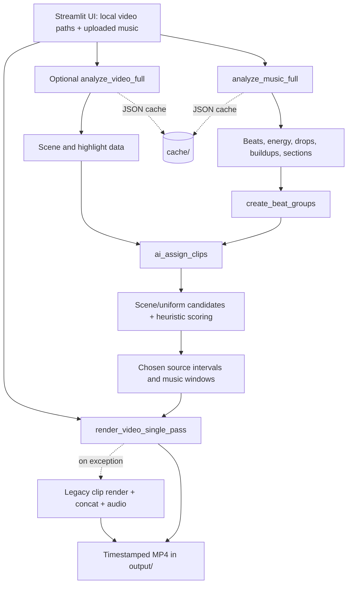

# Complete Project Analysis

## 1. Project Overview

Beats Video Editor is a local Python application that assembles a video montage from source video files and a music track. Its intended result is a sequence of selected source-video intervals whose durations follow groups of detected music beats, with optional transitions and the music track as the final audio.

The main interface is a Streamlit web UI in `app/frontend.py`. A user supplies local paths to one or more videos, uploads music, chooses processing options, and starts generation. The program analyzes music with librosa, finds video scene boundaries with FFmpeg, creates candidate trim points, scores candidates with heuristics, and renders the selected timeline with FFmpeg. A command-line path also exists in `app/main.py`, while `tools/run_headless_test.py` and `tools/benchmark.py` provide test/measurement entry points.

“AI” in the UI and project name describes heuristic automatic matching. The checked-in runtime code does not load a learned model, use a prompt, call a cloud AI service, create embeddings, or use an agent. The current matching is built from beat strength/energy, scene-boundary flags, time proximity, optional Farneback optical-flow motion, highlight overlap, and clip/source usage heuristics.

The specification and planning documents describe a more ambitious target design than the implementation. They are useful context, not evidence that every specified stage is implemented. In particular, the current code does not implement face detection, semantic scene understanding, cross-modal audio/video embeddings, an ML model, or a complete structured debug report as described in those documents.

## 2. Project Structure

The checkout contains 46 tracked files. The inventory below includes source, configuration, tests, documentation, media, caches, logs, and compiled artifacts. Cache and log contents can include local media paths; those values are intentionally not reproduced here.

### Root files

| Path | Purpose and observations |
| --- | --- |
| `README.md` | Quick setup and run instructions, FFmpeg prerequisites, and examples for low-memory encoding. The setup example is PowerShell/Windows-oriented. |
| `SPEC.md` | Desired end-to-end product and pipeline specification: analysis stages, candidate scoring, rendering, UI, configuration, and test criteria. Some parts do not match current code. |
| `ai_implement.md` | Proposed heuristic/ML-assisted matching design and integration plan. It mentions Torch, torchvision, embeddings, and flags that are not part of the checked-in runtime dependency set or current implementation. |
| `optimiz.md` | Historical performance recommendations. Treat code blocks as proposals, not necessarily as implemented or still accurate behavior. |
| `benchmark.txt` | UTF-16LE captured benchmark transcript. It contains machine-local input names/paths, omitted here. The captured run reported zero clip assignments and zero music coverage at its assignment stage. |
| `requirements.txt` | Unpinned Python dependencies: librosa, numpy, soundfile, scipy, numba, streamlit, opencv-python, Pillow, and psutil. |
| `setup_env.ps1` | Windows PowerShell virtual-environment creation and dependency installation script. It is not a Linux shell script. |
| `.gitignore` | Ignores virtual environments, bytecode, `data/`, `output/`, upload temp files, and MP4/MP3 patterns. Despite those rules, the current checkout tracks cache/log/bytecode artifacts and `data/music/song.mp3`. |
| `.streamlit/config.toml` | Sets a 12,288 MB upload limit, disables Streamlit XSRF protection, and disables browser usage-stat collection. |

### `app/` source modules

| Path | Responsibility |
| --- | --- |
| `app/__init__.py` | Empty package marker. |
| `app/frontend.py` | Streamlit UI; reads local source-video paths and a music upload, maintains session state, starts a background generation thread, shows progress, performs matching/rendering, and offers outputs for download/playback. |
| `app/main.py` | Simple command-line entry point using fixed paths under `data/` and `output/`; invokes music analysis, matching, legacy clip rendering, concatenation, remux, and audio addition. |
| `app/beat.py` | Beat detection and richer music analysis: tempo, beat strength/energy, RMS energy curve, drop/buildup heuristics, and simple chroma-change section labeling. |
| `app/sync.py` | Beat grouping, candidate scoring and assignment (greedy or SciPy Hungarian), beat classification, constraints/fallbacks, and legacy/random or AI-named synchronization APIs. |
| `app/video.py` | FFmpeg/ffprobe integration; video metadata, scene and motion analysis, candidate generation, clip trimming, transitions, concatenation, audio muxing, and single-pass rendering. |
| `app/cache.py` | Process-wide singleton cache manager, JSON cache helpers/decorator, generic threaded item processing, and a background-future helper. |
| `app/progress_tracker.py` | Weighted stage progress, elapsed/estimated time, statistics, and optional dashboard callbacks. |
| `app/logging_system.py` | Singleton logger setup with rotating app/render/analysis/FFmpeg files, console output, and optional frontend callback. |
| `app/theme.py` | Entirely commented-out MoviePy theme/filter experiment; currently has no runtime behavior. |

### Other directories and every checked-in artifact

| Path(s) | Purpose and observed state |
| --- | --- |
| `tools/benchmark.py` | Times music/video analysis, candidate generation, assignment, and optional legacy rendering; prints coverage and source-diversity metrics. |
| `tools/run_headless_test.py` | Argument-driven legacy pipeline runner; can synthesize a short video with FFmpeg, then analyze, sync, concatenate, remux, and add audio. Its `--debug` option is parsed but not used. |
| `test_pipeline.py` | Manual end-to-end test using `data/videos/test_video.mp4` and `data/music/song.mp3`. It returns `False` for missing fixtures rather than asserting, and it is not a conventional pytest assertion test. |
| `test_multi_video_greedy_path.py` | Regression test for the multi-video greedy assignment path. It hard-codes external video/music fixture paths and includes a Windows path in `sys.path`; those external fixtures are not in this checkout. |
| `data/music/song.mp3` | Tracked MP3 sample asset (about 192 seconds, 44.1 kHz stereo). No video fixture or `data/videos/` directory is present in this checkout. |
| `cache/beats/32676acf964dc573_beats.json`, `cache/beats/7a3ea05f7bb5b94b_beats.json`, `cache/beats/d61f2e5a62eed46b_beats.json` | Three valid JSON empty lists (`[]`), retained beat-cache artifacts. |
| `cache/motion/7af18bf36641f6aa_motion_0.8.json` | Empty file, not valid JSON. |
| `cache/music_analysis/77abf71f732b1050.json`, `cache/music_analysis/80fe6a0aaf017ded.json`, `cache/music_analysis/9d8479b9e1137743.json`, `cache/music_analysis/a21c9ae107a43d7c.json`, `cache/music_analysis/b7a82d7e52d15021.json`, `cache/music_analysis/bc8a6709068e741e.json` | Six valid, byte-for-byte identical large JSON music-analysis payloads. Their keys match the result schema in `app/beat.py`. |
| `cache/video_analysis/bd4d1b44072527c6_skip30.json`, `cache/video_analysis/c7fae45331cbac2b_skip30.json` | Two valid video-analysis result objects with metadata and scene arrays; their optional heavy-analysis arrays are empty in these cached examples. |
| `logs/app.log` | 284-line historical application log, mostly repeated candidate-generation INFO records plus one warning. Local input names are not reproduced. |
| `logs/analysis.log` | Empty analysis log placeholder. |
| `logs/ffmpeg.log` | Empty FFmpeg log placeholder. |
| `logs/render.log` | Empty render log placeholder. |
| `app/__pycache__/__init__.cpython-312.pyc`, `app/__pycache__/beat.cpython-312.pyc`, `app/__pycache__/main.cpython-312.pyc`, `app/__pycache__/sync.cpython-312.pyc`, `app/__pycache__/theme.cpython-312.pyc`, `app/__pycache__/video.cpython-312.pyc` | Six tracked CPython 3.12 bytecode artifacts. Several record source sizes that do not match the current, much larger Python sources, so they are stale generated artifacts. The readable `.py` files are the source of truth. |

## 3. Code Analysis

### Main execution flow: Streamlit

1. Importing `app/frontend.py` establishes the repository root, creates `output/` and `temp_uploads/`, imports the processing modules, and configures the Streamlit page.
2. `main()` asks for local video paths in a text area and a music upload. It accepts `.mp4`, `.mov`, `.webm`, and `.mkv` videos. Music is streamed from Streamlit's uploaded-file object into a per-session temporary directory.
3. The user configures beat-group sizes, sampling interval, scene threshold, motion, transitions, output size, intro skip, and optional video-analysis mode.
4. Clicking Generate stores parameters and starts `run_generation()` on a daemon thread.
5. Music is analyzed by `analyze_music_full()`. By default, video analysis is lazy; otherwise, `analyze_video_full()` runs concurrently for up to four videos.
6. `ai_assign_clips()` creates beat groups, detects or reuses scene analysis, generates candidates, and selects source intervals. Despite its name, this step is a custom heuristic matcher.
7. The primary render is `render_video_single_pass()`: it opens unique source videos and the music track, trims/normalizes each assignment in a filter graph, adds transitions or a concat filter, encodes video, and muxes audio.
8. If the single-pass call raises, the UI falls back to per-clip `process_clip()`, then legacy concatenation/transitions, optional remux, and `add_audio()`.
9. The final output is saved under the repository's `output/` directory with a timestamped filename. The temporary upload/work directory and music file are removed in `finally`.

### Other execution paths

- `app/main.py` uses constants `data/music/song.mp3`, `data/videos`, and `output`. It calls `sync_clips_with_beats(..., ai_mode=True)` and then uses the legacy per-clip render/concatenate/remux/audio sequence.
- `tools/run_headless_test.py` defaults to the legacy non-AI sync path. With `--ai` it passes matching options, but it does not pass `music_analysis`, so energy/drop metadata is unavailable to that path. It requires the sample music file and attempts to create `data/videos/test_video.mp4` if missing; it does not create the parent directory first.
- `tools/benchmark.py` directly times the analysis and assignment APIs. Its benchmark render deliberately skips actual audio muxing because the helper does not receive a music path.

### Module interaction

`frontend.py` and `main.py` orchestrate work. `beat.py` yields music features. `sync.py` consumes beats plus `video.py`'s metadata, scene, candidate, motion, and frame-snapping helpers; its result is a list of chosen source intervals aligned to music beat groups. `video.py` turns those intervals into encoded media. `cache.py` is used by analysis functions, while `logging_system.py` and `progress_tracker.py` provide operational visibility.

The legacy API `sync_clips_with_beats()` returns generated clip paths, clip/beat metadata, and a temporary directory. Its `ai_mode=True` branch calls `ai_assign_clips()` and renders each assignment individually. Its default branch randomly selects videos and beat groups. The frontend usually bypasses that wrapper and calls `ai_assign_clips()` plus the single-pass renderer directly.

## 4. Technologies and Dependencies

### Languages and runtime

- Python is the only application language. The README says Python 3.8+, but the code uses built-in generic annotations such as `list[dict]`; Python 3.9+ is the safe minimum for the source as written.
- Markdown, TOML, JSON, PowerShell, and FFmpeg filter/command syntax appear in documentation, configuration, cached data, setup, and media operations.

### Python packages

| Dependency | Role in checked-in code |
| --- | --- |
| `librosa` | Loads mono audio and estimates tempo/beats, onset strength, RMS energy, and chroma features. |
| `numpy` | Numeric arrays and vectorized candidate scoring; used alongside librosa and OpenCV. |
| `scipy` | Optional `scipy.optimize.linear_sum_assignment` implementation for the small-problem Hungarian assignment path. The code attempts a greedy fallback if SciPy import fails, but that fallback currently has a variable-order defect described below. |
| `opencv-python` (`cv2`) | Video frame resizing, grayscale conversion, Farneback optical flow, histograms, sharpness, and simple color statistics. |
| `Pillow` (`PIL`) | Decodes FFmpeg-extracted PNG frames. |
| `streamlit` | Local browser UI, upload controls, session state, progress fragments, playback, and downloads. |
| `psutil` | Process resident-memory display in the UI. |
| `soundfile`, `numba` | Declared dependencies used by the audio stack and/or librosa's optional acceleration; they are not directly imported by the checked-in app modules. |

There are no dependency version pins, lockfile, package/build manifest, or requirements entry for pytest. Torch/torchvision, MoviePy, cloud SDKs, and embedding packages mentioned in design notes are not required or used by the current app (the MoviePy theme module is commented out).

### External tools and APIs

- `ffmpeg` performs scene scanning, frame extraction, clip trimming, filtering, transitions, concatenation, encoding, remuxing, and audio muxing.
- `ffprobe` provides duration and stream metadata.
- Both executables must be on `PATH`. Intel QSV is selected when FFmpeg lists `h264_qsv`; CPU encoding uses `libx264`. The code does not call a remote API or external hosted service.

## 5. Architecture and Data Flow



### Music data

`get_beats()` returns dictionaries with `time` and normalized `strength`. `analyze_music_full()` returns `bpm`, `beats` (with energy added), `drops`, `buildups`, `sections`, `energy_curve`, and `duration`. It reads the entire audio track into a mono librosa array, but does not resample it (`sr=None`).

### Video data

`analyze_video_full()` returns source path, duration, frame rate, dimensions, scenes, motion profile, highlights, camera-change times, visual-quality samples, and dominant colors. `fast_mode=True` (the default) performs scene detection but leaves motion, highlights, camera changes, quality, and color arrays empty. Candidate generation separately samples scene boundaries and uniform timestamps, skipping the configured intro where possible.

### Matching and rendering

Beat groups are built by randomly choosing a group size between configured beat limits. Greedy matching scores candidate locations with scene bonus, beat-time proximity, motion, highlights, type-specific bonuses, an energy multiplier, temporal-diversity penalties, and multi-video distribution bonuses. Assignment uses random weighted choice among a short top-candidate pool, so identical inputs are not guaranteed to create identical edits.

For smaller estimated problems, `ai_assign_clips()` pre-generates candidates and calls `_hungarian_assign()`; larger problems go straight to `_greedy_assign()`. The single-pass render uses FFmpeg `trim`, `setpts`, scaling/padding, FPS/SAR normalization, color grading, transitions (`xfade`) or `concat`, a final filter chain, and AAC audio. The legacy renderer creates groups and intermediate MP4s before transition encoding and audio muxing.

## 6. Configuration and Setup

### Configuration sources

- No `.env` file, environment-variable configuration, or external service credentials are used by the checked-in code.
- Many defaults are module constants in `app/video.py`: 1920x1080, 30 FPS, scene threshold 0.3, sample interval 0.5 seconds, candidate cap 100, intro skip 30 seconds, minimum source gap 3 seconds, and transition defaults. The Streamlit UI overrides many of these at runtime; its initial sample interval is 2 seconds and scene threshold is 0.4.
- Encoder settings are hard-coded: QSV quality 14/slow preset and CPU libx264 CRF 15/slower preset. The UI's target-resolution control provides 720p, 1080p, or 4K.
- `CacheManager` always uses repository-relative `cache/`. `cache_dir` arguments accepted by analysis functions are not used to select that cache root.
- `.streamlit/config.toml` sets a 12 GB upload limit and disables XSRF protection. Browser usage statistics are disabled.
- The UI stores uploads in `temp_uploads/` and renders final outputs to `output/`. The batch entry point expects `data/videos/` plus `data/music/song.mp3`.

### Requirements

1. Install Python 3.9 or newer (Python 3.10+ is a practical choice for current package wheels).
2. Install FFmpeg and ffprobe and make both available on `PATH`.
3. Create a virtual environment and install the pinned-by-name, unpinned-by-version requirements:

```bash
python -m venv .venv
source .venv/bin/activate
python -m pip install --upgrade pip
python -m pip install -r requirements.txt
```

`setup_env.ps1` implements the equivalent Windows PowerShell setup, not the shell commands above. On Windows, activate the environment with the script's printed activation command if needed.

## 7. How to Run and Develop

### Streamlit UI

From the repository root, with the environment active:

```bash
streamlit run app/frontend.py
```

Enter readable paths to source videos in the sidebar, upload a supported music track, choose processing options, and select **Generate AI Video**. Outputs appear in `output/` and are exposed for playback/download in the UI. The uploaded music and per-session temp data are removed after generation; source videos referenced by local path are not copied into the upload directory.

### Batch entry point

`app/main.py` is run as a Python module/script from the project root after placing video files in `data/videos/` and a track at `data/music/song.mp3`:

```bash
python -m app.main
```

It writes `output/final.mp4` and removes its `_work` directory on successful completion. Its cleanup is not in a `finally` block, so failures may leave work files behind.

### Headless runner

```bash
python tools/run_headless_test.py --help
python tools/run_headless_test.py --ai --no-motion
```

The runner expects `data/music/song.mp3`. It attempts to make a synthetic ten-second video if `data/videos/test_video.mp4` does not exist, but the parent directory must already exist. Its `--debug` flag currently does not change behavior; AI mode's sync wrapper writes debug output independently when it succeeds.

### Tests and benchmark

The checked-in tests are standalone scripts, not a complete, self-contained automated suite:

```bash
python test_pipeline.py
python test_multi_video_greedy_path.py
```

Both need media not included in this checkout (the first needs `data/videos/test_video.mp4`; the regression test needs several external `output/` videos and a temporary upload). The second also contains a hard-coded Windows path. Treat failures from missing fixtures separately from code failures. The pipeline test's `False` return for missing inputs is not asserted, so a pytest invocation may not fail as expected.

Benchmark with explicit local assets:

```bash
python tools/benchmark.py /path/to/music.mp3 /path/to/video1.mp4 /path/to/video2.mp4 --skip-render
```

No automated formatter, type checker, lint configuration, or reproducible dependency lock is present. A useful development sequence is to add small unit tests around beat grouping, duration buckets, candidate constraints, and render-command construction before relying on media-heavy end-to-end runs.

## 8. Important Functions, Classes, and Responsibilities

### Music (`app/beat.py`)

- `get_beats()` and `_get_beats_cached()` call librosa beat tracking, filter/sort timestamps, sample onset strengths, normalize strengths, and return beat dictionaries. Broad failures print an error and return an empty list.
- `analyze_music_full()` adds RMS energy, beat energy, threshold-based drops, rising-energy buildups, and chroma-change sections. It uses the global cache manager; its `cache_dir` parameter is currently unused.
- `get_beat_times()` is a compatibility adapter returning float timestamps.

### Synchronization (`app/sync.py`)

- `_normalize_beats()` converts float timestamps to beat dictionaries.
- `create_beat_groups()` groups contiguous beats using random group sizes, extends the last group toward music duration, and may append synthetic groups.
- `classify_beat_type()` labels a beat as drop/buildup/downbeat/regular by thresholds and local beat strength.
- `_energy_match_weight()` increases score weights for matching motion to low/high energy.
- `_compute_diversity_penalty()` scores distance from already-used source intervals.
- `_greedy_assign()` generates/reuses candidates, applies constraints and score components, balances source usage, chooses among top candidates probabilistically, and falls back to finer-grained search.
- `_hungarian_assign()` builds a beat-by-candidate cost matrix and calls SciPy's `linear_sum_assignment`; its constraints/metadata handling differ from greedy behavior.
- `ai_assign_clips()` runs preflight estimates, chooses Hungarian or greedy, and adapts assignments to the shared output shape (`source_path`, music interval, source interval, score, beat metadata).
- `sync_clips_with_beats()` supports AI and legacy random modes, processes each selected clip for the legacy pipeline, and attempts to write JSON debug files.

### Video (`app/video.py`)

- `snap_to_frame()` rounds timestamps to the nearest 30 FPS frame by default.
- `get_video_duration()` and `get_video_info()` use ffprobe; both are LRU-cached by path.
- `detect_scene_changes()` and `detect_scenes_detailed()` parse FFmpeg `showinfo` output; the detailed variant builds time segments and skips the intro region.
- `generate_candidates()` combines scene starts with uniformly sampled valid source starts, deduplicates and caps them, and optionally calls motion analysis.
- `extract_frame()`, `compute_optical_flow_magnitude()`, `analyze_motion_segment()`, and `analyze_motion_at_candidates()` extract frames and optionally score motion using Farneback optical flow. Candidate motion scores may be cached.
- `analyze_video_full()` combines metadata and scenes; `fast_mode=False` additionally computes motion, highlights, camera changes, quality, and colors. Results are cached.
- `process_clip()` trims and normalizes a single source interval, prefers QSV, falls back to libx264, then validates output dimensions and duration.
- `create_concat_file()`, `concat_group()`, `create_random_groups()`, `create_transition_video()`, and `concatenate_videos()` implement the intermediate-file legacy render pipeline.
- `encode_in_chunks()` does not encode chunks: despite its name, it performs a stream-copy remux.
- `add_audio()` loops audio with `-stream_loop -1`, maps video and music, encodes AAC, and cuts at the shortest stream.
- `render_video_single_pass()` builds one FFmpeg filter graph for all assignment trims, optional transitions or concat, final video filters, and audio muxing.

### Supporting modules

- `CacheManager` in `app/cache.py` is a double-checked singleton. `get_file_hash()` hashes the path, size, and mtime (not file contents); JSON load/save helpers and `cached()` use that key. `parallel_process()` retains result order and returns exceptions as result values. `run_in_background()` submits work inside a `ThreadPoolExecutor` context manager, whose exit waits for completion, so it is not truly non-blocking.
- `ProgressTracker`, `StageProgress`, and `ProcessingStats` in `app/progress_tracker.py` track weighted progress, elapsed time, and a coarse ETA. The UI polls the tracker; it does not pass the optional callback.
- `LogManager` in `app/logging_system.py` creates rotating file handlers and console handlers and can forward selected messages to a UI callback.
- `main()` in `app/frontend.py` owns UI state and dispatch; `run_generation()` owns the staged processing and cleanup; `progress_dashboard()` reads current stats; `get_generated_videos()` enumerates prior outputs.

## 9. AI / ML Components

There is no learned AI model in the executable project. “AI matching” is a deterministic collection of handcrafted scoring terms plus random choices among high-scoring candidates. The randomness in beat-group sizes and candidate selection also means runs can vary.

The actual analysis algorithms are conventional signal/video processing:

- librosa beat tracking and onset strength for beats;
- RMS audio amplitude for normalized energy;
- positive RMS changes and energy thresholds for drop candidates;
- multi-beat energy rise for buildup candidates;
- chroma feature differences for section boundaries;
- FFmpeg scene-change scores for cuts;
- optional OpenCV Farneback flow for motion;
- sampled histogram, Laplacian, brightness, contrast, and mean-color measurements in the non-fast video-analysis functions.

The current “sections” are not learned or semantically recognized sections. Energy thresholds label segments, while boundaries come from high chroma-difference frames. Face detection, action recognition, trained visual quality models, embeddings, prompts, agents, and audio-visual similarity are absent. The ML plans in `ai_implement.md` are proposals; their Torch/ResNet/MFCC/Hungarian-extension examples are not a description of what currently runs.

## 10. Potential Issues and Improvements

Findings below are based on static inspection and checked-in historical artifacts; they have not been repaired as part of this documentation-only task.

### Correctness and reliability

1. **Progress callback lock re-entry (`app/progress_tracker.py`).** `start_stage()`, `update_stage_progress()`, and related methods invoke `_notify()` while holding a standard `threading.Lock`. If a caller provides `frontend_callback`, `_notify()` calls `get_dashboard_data()`, which tries to acquire the same lock again. That callback configuration can deadlock. The current Streamlit UI constructs the tracker without a callback and polls it, avoiding this specific path.
2. **Broken internal Hungarian fallback (`app/sync.py`).** `_hungarian_assign()` can call `_greedy_assign(..., source_durations=source_durations)` in its SciPy-import-failure and oversized-matrix branches before `source_durations` is assigned later in the function. Those fallback branches can raise `UnboundLocalError`.
3. **Hungarian path constraint and metadata drift (`app/sync.py`).** Its matrix scores candidates using initially empty used intervals, does not update chronological cursors, and validates overlap/reuse only while iterating the solver output without re-solving rejected rows. It therefore does not implement the same global constraints as greedy assignment. The final assignment loop also writes `beat_strength`, `beat_energy`, and `beat_type` variables last set by the preceding matrix-building loop, so multiple output rows can carry the last beat's metadata.
4. **AI debug serialization shape mismatch (`app/sync.py`).** `all_candidates[video]` is a mapping from duration to candidate lists, but the debug writer iterates it as if it were a flat list of candidate dictionaries. Its indexing can raise a type error; the exception is caught and only a warning is printed, so the promised debug file may be absent.
5. **Inconsistent empty-result contract (`app/sync.py`).** `ai_assign_clips()` normally returns four values but returns a bare empty list if there are no beat groups. Callers that unpack four values can fail on this edge case.
6. **Coverage calculations need tests (`app/sync.py`).** Beat groups begin at the first detected beat rather than necessarily at time zero. Extending the last group and calculating remaining coverage from summed group durations can omit or over-create intervals. The spec's full-coverage guarantee should be tested against the actual rendered duration and music duration.
7. **Single-pass audio is not looped (`app/video.py`).** `render_video_single_pass()` maps the music input and uses `-shortest` but does not set `-stream_loop -1`; if music is shorter than the timeline, the output can end early. The legacy `add_audio()` does loop the music.
8. **No hardware-encoder retry in full renders (`app/video.py`).** `check_qsv()` only checks whether FFmpeg lists the encoder. `process_clip()` retries with CPU after a QSV error, but `render_video_single_pass()` and transition rendering select QSV and do not retry the render on CPU failure.
9. **Historical benchmark failed assignment (`benchmark.txt`).** The checked-in transcript reached assignment but reported zero assigned clips and zero music coverage for that run. It is historical evidence, not a current reproducible test, but it warrants a deterministic regression fixture.

### Analysis quality and performance

10. **Section over-segmentation (`app/beat.py`).** A per-frame chroma-difference percentile is used as a section boundary threshold without a minimum segment duration or boundary merge. The captured benchmark reported thousands of sections for a track of a few minutes, so labels should not be interpreted as reliable musical structure.
11. **Fast mode and motion defaults limit matching signals.** `analyze_video_full(fast_mode=True)` returns empty highlights/motion metadata; the UI also defaults `compute_motion` to false. In that default, matching lacks motion/highlight evidence and leans heavily on scene flags, proximity, and usage bonuses.
12. **Repeated FFmpeg frame extraction (`app/video.py`).** Motion and full video profiles launch FFmpeg separately for each sample frame. This can be expensive for long videos or many candidates; batched extraction or a streaming decoder would reduce process overhead.
13. **Render memory use (`app/frontend.py`).** Prior output downloads call `f.read()` on the entire MP4 for every displayed download button, and final download does the same. Large outputs can consume substantial RAM. Streamlit also receives large-upload buffers before the app streams chunks to disk.
14. **No real chunked encoding (`app/video.py`).** `encode_in_chunks()` is a remux, not a segment-based low-RAM encode. UI labels and docs should distinguish remuxing from chunked re-encoding.

### State, cache, tests, and security

15. **Cache arguments and invalidation (`app/cache.py`, `app/beat.py`, `app/video.py`).** Analysis `cache_dir` parameters do not change the global `cache/` location. Cache keys use path, size, and mtime rather than file content; the in-memory path hash map is never refreshed. `get_video_duration()` and `get_video_info()` also cache by path. Replacing a file at an existing path can return stale analysis/metadata. `clear_all()` omits the `music_analysis` category.
16. **Upload/session cleanup state (`app/frontend.py`).** `run_generation()` removes the temp directory and uploaded music but does not clear all related Streamlit session-state paths. Reusing an old upload state may leave references to deleted files. Video-input change detection compares only basenames, so same-named videos from different directories can be treated as unchanged.
17. **Thread and UI state access (`app/frontend.py`).** The worker thread writes `st.session_state` directly. Streamlit APIs generally expect script-thread context; result delivery should use a thread-safe queue or a documented supported mechanism.
18. **XSRF disabled (`.streamlit/config.toml`).** Disabling XSRF protection is risky if the UI is exposed beyond a trusted local environment. No authentication layer is configured in this repository.
19. **Tests are not self-contained (`test_pipeline.py`, `test_multi_video_greedy_path.py`).** Required videos are absent, the regression test uses machine-specific external files and a Windows path, and the pipeline test does not assert its false return. Add generated fixtures and focused tests that run on Linux/Windows without user media.
20. **Setup/reproducibility gaps.** Requirements are unpinned; the setup script is Windows-only; README's Python 3.8 minimum is inconsistent with built-in generic annotations used in the source. Add a supported Python range, version constraints/lock strategy, and Linux/macOS setup documentation.
21. **Tracked generated/personal artifacts.** Cache data, logs, `__pycache__`, and sample media are tracked even though ignore patterns cover much of this material. The logs and benchmark capture machine-local media identifiers. Keep such artifacts out of future commits or sanitize them before sharing.
22. **Maintainability.** `app/video.py` combines analysis, FFmpeg command construction, selection helpers, rendering, and audio muxing. `app/frontend.py` combines input handling, state, orchestration, rendering fallback, and presentation. Split these responsibilities gradually behind tested interfaces; remove unreachable duplicated code after `process_clip()`'s return and unused imports/flags during separately reviewed cleanup.

## 11. Learning Guide

### Beginner path

1. Start with `README.md` for the product intent and basic command, then compare its claims with `app/frontend.py`'s actual UI.
2. Read `app/main.py` to understand the shortest batch-style orchestration path.
3. Read `app/beat.py` to learn the input/output shape for beat and music features.
4. Read `app/video.py`'s constants, metadata helpers, scene detection, and `generate_candidates()` to understand source-video time ranges.
5. Read `app/sync.py`'s `_normalize_beats()`, `create_beat_groups()`, and `ai_assign_clips()` to connect music time to source-video intervals.
6. Follow `process_clip()` and `render_video_single_pass()` to see how selected intervals become an MP4.

### Intermediate path

Study `_greedy_assign()` next, tracing a candidate through filters, score terms, top-pool sampling, interval bookkeeping, and fallback search. Then compare `_hungarian_assign()` to identify where its constraints differ. Read `app/cache.py`, `app/progress_tracker.py`, and `app/logging_system.py` for shared services. Finally, trace `run_generation()` from upload/session parameters to output cleanup in `app/frontend.py`.

### Advanced path

Inspect the FFmpeg filter graph in `render_video_single_pass()`, timestamp/timebase normalization, transition offsets, and encoder fallback behavior. Then inspect energy/section heuristics in `analyze_music_full()`, cache-key validity, concurrent analysis in the frontend, and regression coverage. Read `SPEC.md`, `ai_implement.md`, and `optimiz.md` only after the code so proposed features and optimization ideas remain clearly distinguished from current behavior.

When changing matching logic, preserve and test the assignment data contract: each output needs a source path, source start, clip duration, music start/end, score, and optional scene/motion/beat metadata. Also test final duration, non-overlapping source intervals, intro-skip boundaries, and behavior when SciPy or QSV is unavailable.

## 12. Final Summary

This repository is a local Streamlit-based beat-synchronized video montage tool. Its major concepts are librosa-based music features, FFmpeg/OpenCV-based source analysis, duration-specific candidate sampling, heuristic beat-to-clip assignment, and FFmpeg rendering. The browser UI is the primary user workflow; the CLI and headless tools use older paths. There is no trained AI model or remote AI service in the runtime.

Before extending it, understand the data contract between `app/beat.py`, `app/sync.py`, and `app/video.py`; distinguish greedy matching from the Hungarian path; and distinguish the single-pass render from the legacy path. The design docs describe goals that are not all implemented. Add portable media fixtures and focused tests before relying on claimed full-coverage, energy-matching, debug-output, fallback, or low-memory behavior. This analysis documents the checked-in state only and does not modify project source code.